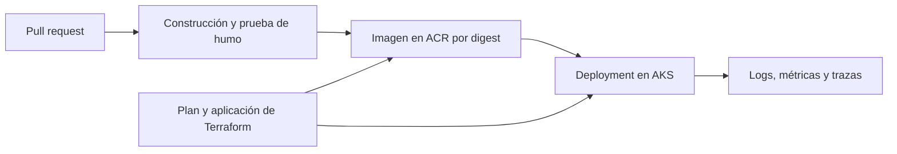

# Taller de DevOps de Docker a Azure AKS

Un taller de una hora para desarrolladores sénior y arquitectos. Usaremos un mismo ejemplo para conectar los conceptos de Docker, CI/CD, Terraform y Kubernetes con las prácticas de producción. Empieza por la [guía para dirigir la sesión](docs/senior-session.md).

Para el ensayo necesitas Docker con Compose, Git, Bash, curl y Python 3. Para Kubernetes, instala también [kubectl](https://kubernetes.io/docs/tasks/tools/install-kubectl/) y elige entre [kind](https://kind.sigs.k8s.io/docs/user/quick-start/) y [k3d](https://k3d.io/stable/). Instala Terraform para los ejercicios de infraestructura.

| Sistema | Dónde ejecutar los comandos |
| --- | --- |
| Windows | Instala [WSL 2 con Ubuntu](https://learn.microsoft.com/windows/wsl/install) y activa la [integración de Docker Desktop con Ubuntu](https://docs.docker.com/desktop/features/wsl/). Usa contenedores Linux. Instala las herramientas de línea de comandos dentro de Ubuntu y clona el repositorio ahí, por ejemplo bajo `~/src`. Los bloques Bash se ejecutan en Ubuntu. |
| macOS | Arranca Docker Desktop y ejecuta los bloques desde Terminal. Instala las herramientas para la arquitectura de tu Mac. |

Comprueba `docker version` y `docker compose version` desde la misma terminal en la que vas a trabajar. La [práctica de Terraform con k3s](docs/k3s.md) usa los mismos comandos en ambos sistemas.

## Primeros pasos

```bash
docker compose up -d --build --wait
./scripts/smoke.sh
docker compose logs demo
docker compose down
```

La prueba de humo muestra dos resultados de Saga con datos sintéticos. Busca cada `saga_id` en los logs JSON. Si el pago se confirma, la Saga registra `inventory_reserved` y `payment_confirmed` y la reserva queda activa. Si el pago se rechaza, registra `inventory_reserved`, `payment_rejected` e `inventory_released`. Liberar la reserva es la acción de compensación y en esta demo ocurre dentro de la misma petición. Una Saga distribuida debe guardar el progreso para poder reintentar y compensar de forma segura tras un reinicio.

Para repetir solo el rechazo, ejecuta `curl -fsS -X POST 'http://127.0.0.1:8080/sagas?fail=true'` mientras sigues los logs en otra terminal con `docker compose logs -f demo`.

Antes de la sesión, ejecuta la prueba de humo con Compose, crea el clúster de kind y prueba el [ejemplo de pedidos con RabbitMQ, Saga y outbox](docs/ejemplo.md). Si el puerto 8080 está ocupado, usa `DEMO_PORT=18080 docker compose up -d --build --wait` y `./scripts/smoke.sh http://127.0.0.1:18080`. Si Kubernetes local no está disponible, haz la demo con Compose y muestra el manifiesto y una ejecución exitosa de GitHub Actions.

## Despliegue en Kubernetes local

```bash
kind create cluster --name devops-lab
docker build -t devops-demo:local .
kind load docker-image --name devops-lab devops-demo:local
kubectl --context kind-devops-lab apply -f k8s/
kubectl --context kind-devops-lab -n devops-lab rollout status deploy/demo --timeout=120s
kubectl --context kind-devops-lab -n devops-lab get pods,svc
kubectl --context kind-devops-lab -n devops-lab port-forward svc/demo 8080:8080
```

En una segunda terminal, ejecuta `./scripts/smoke.sh` y `kubectl --context kind-devops-lab -n devops-lab logs -l app=demo --prefix`. Para mostrar la reconciliación, elimina un Pod de la demo por nombre y observa cómo el Deployment lo sustituye. Si un despliegue se atasca, consulta primero `rollout status` y revisa después `describe pod`, los logs de los contenedores y los eventos del namespace. Antes de desplegar a producción, identifica qué digest de imagen puedes restaurar y qué migraciones de base de datos son compatibles con esa versión.

Para mostrar el despliegue de una versión y su rollback, detén el port-forward y ejecuta estos comandos.

```bash
kubectl --context kind-devops-lab -n devops-lab set env deploy/demo APP_VERSION=v2
kubectl --context kind-devops-lab -n devops-lab rollout status deploy/demo --timeout=120s
```

Vuelve a abrir el port-forward y ejecuta `./scripts/smoke.sh http://127.0.0.1:8080 v2` en la segunda terminal para comprobar la versión y ambos resultados de la Saga. Detén el port-forward y ejecuta estos comandos.

```bash
kubectl --context kind-devops-lab -n devops-lab rollout undo deploy/demo
kubectl --context kind-devops-lab -n devops-lab rollout status deploy/demo --timeout=120s
```

Vuelve a abrir el port-forward y ejecuta `./scripts/smoke.sh http://127.0.0.1:8080 local`. La demo cambia una variable de entorno en la plantilla del Pod para que puedas reconocer la versión en la respuesta. Al desplegar un cambio de código se actualiza el digest de la imagen. El rollback de Kubernetes recupera una plantilla de Pod anterior. La compensación de una Saga revierte un efecto de negocio mediante otra acción.

Detén el port-forward y elimina el clúster del taller con `kind delete cluster --name devops-lab`.

## Práctica local con Terraform

Ejecuta estos comandos desde la raíz del repositorio.

```bash
terraform -chdir=infra/local init
terraform -chdir=infra/local plan -out=lab.tfplan
terraform -chdir=infra/local apply lab.tfplan
terraform -chdir=infra/local output
terraform -chdir=infra/local plan -var=environment=staging
terraform -chdir=infra/local destroy
```

El primer plan propone crear un recurso `terraform_data` que guarda un valor deseado de dos réplicas. El segundo muestra cómo cambiar el entorno sin reemplazar el recurso. El ejercicio usa el proveedor integrado de Terraform y guarda el estado en local. Al gestionar infraestructura de Azure en equipo, usa un estado por entorno, un backend remoto con bloqueo y un paso de aplicación sujeto a revisión.

## Del taller a Azure

La [variante Terraform con Container Apps](docs/azure-container-apps.md) reparte la Saga de pedidos entre Container Apps, Service Bus, PostgreSQL, ACR y Azure Monitor. La [comparativa de arquitecturas](docs/azure-variantes.md) incluye también Functions y App Service. La opción con AKS se describe a continuación.



GitHub Actions construye y prueba la imagen con Compose. Después carga esa misma imagen en kind para verificar el despliegue inicial, el cambio de versión y el rollback. Para entregar en Azure, publica la imagen probada en ACR y promueve el mismo digest entre entornos. Revisa el plan de Terraform por separado de los despliegues de la aplicación. Consulta la [guía de Azure para el taller y producción](docs/azure.md).

Usa kind para practicar con manifiestos, sondas, despliegues y diagnóstico. Si la sesión incluye comprobaciones específicas de Azure, verifica la identidad, la red, el almacenamiento, la monitorización y el coste en una suscripción de pruebas.
