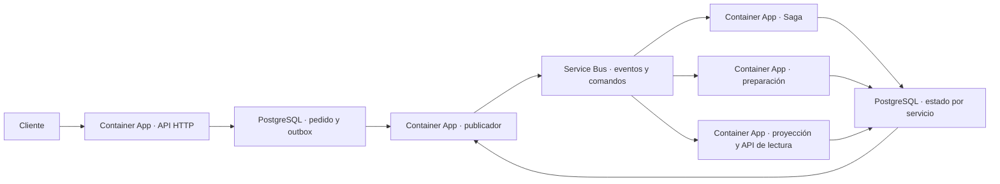
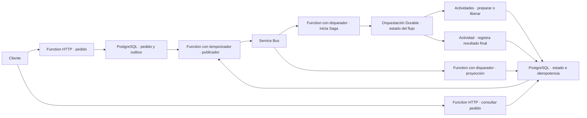
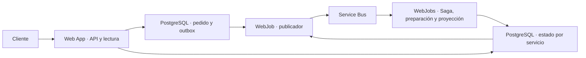

# El mismo flujo de pedidos en Azure

Tres diseños para desplegar la [Saga de pedidos](ejemplo.md) con servicios administrados de Azure. Cada uno conserva el resultado observable del taller: aceptar un pedido, prepararlo o compensarlo, y consultar el resultado. Usa la misma prueba de aceptación para comparar los tres. La [variante Container Apps tiene infraestructura Terraform](azure-container-apps.md). La aplicación del taller se ejecuta en Compose.

| Variante | Se adapta bien a | Cambio principal |
| --- | --- | --- |
| **Azure Container Apps** | Migrar una aplicación que ya tiene imágenes y procesos separados. | Reutilizar los puntos de entrada y sustituir los adaptadores de almacenamiento y mensajería. |
| **Azure Functions** | Procesar mensajes por invocación y delegar la persistencia del flujo. | Dividir el código en disparadores, actividades y una orquestación Durable Functions. |
| **Azure App Service** | Alojar una API web en un plan que el equipo ya opera. | Usar Web App para HTTP y WebJobs continuos para el procesamiento asociado. Separar los procesos si requieren escalar independientemente. |

## Base común

- **Mensajería.** Usa Azure Service Bus Standard o Premium para topics. Asigna una cola de comandos a preparación y un topic de eventos con suscripciones filtradas para Saga y proyección. Cada consumidor tiene su propia suscripción o cola. Mapea la clave de enrutamiento de RabbitMQ a una propiedad como `eventType` y configura filtros explícitos. Elimina el filtro por defecto de recepción general en las suscripciones filtradas. [Colas, topics y suscripciones](https://learn.microsoft.com/en-us/azure/service-bus-messaging/service-bus-queues-topics-subscriptions)
- **Estado de negocio.** Usa Azure Database for PostgreSQL Flexible Server como ejemplo relacional. Separa la propiedad de datos por servicio. Cada productor confirma la escritura de negocio y su outbox en una sola transacción. Cada consumidor guarda el identificador recibido y el efecto en su propia transacción. El publicador reintenta con el mismo `MessageId`. El consumidor confirma la recepción después de confirmar su transacción. Revisa el tiempo del bloqueo de recepción, los reintentos y el máximo de entregas antes de enviar a la cola de mensajes fallidos. [Confirmación y bloqueo en Service Bus](https://learn.microsoft.com/en-us/azure/service-bus-messaging/message-transfers-locks-settlement)
- **Identidad.** Usa identidades administradas con roles `Azure Service Bus Data Sender` o `Azure Service Bus Data Receiver` limitados a los recursos que necesite cada proceso. Separa la identidad que publica imágenes en ACR de la que las descarga. Define también el acceso a los datos de cada servicio.
- **Operación.** Propaga `order_id`, `MessageId` y el contexto de traza a través de Service Bus. Envía telemetría a Azure Monitor y Application Insights. Sigue la antigüedad del outbox, el retraso de las colas, los mensajes fallidos y el tiempo hasta completar o compensar la Saga.

## 1. Azure Container Apps

- Publica la imagen en ACR y despliega por digest. Define aplicaciones separadas para cada proceso, con ingreso HTTP solo donde haga falta. Conserva la máquina de estados de la Saga y adapta los clientes a Service Bus y PostgreSQL.
- Para consumidores continuos, configura escalado según la cola o suscripción. Cada outbox necesita un publicador activo o un mecanismo externo que lo despierte. Una regla sobre Service Bus no detecta filas pendientes en PostgreSQL. Si el propio consumidor drena su outbox, mantenlo con al menos una réplica o separa el drenado antes de permitir que escale a cero. Usa Container Apps Jobs para tareas finitas, como un drenado programado que termina al acabar el lote. [Reglas de escalado](https://learn.microsoft.com/en-us/azure/container-apps/scale-app) · [Container Apps Jobs](https://learn.microsoft.com/en-us/azure/container-apps/jobs)
- Valida el HTTP con una nueva revisión antes de mover tráfico. Para los consumidores, coordina la activación de revisiones y la compatibilidad de mensajes. Una revisión que recibe cero tráfico HTTP puede seguir consumiendo de una cola si continúa activa.

## 2. Azure Functions y Durable Functions

- La función HTTP registra el pedido y su outbox. Publicadores con temporizador drenan los outboxes de la API y de las actividades que generan eventos. Una función HTTP de consulta lee la proyección. Como alternativa al sondeo, un diseño con Cosmos DB puede publicar desde el change feed si cada escritura de negocio y outbox cabe en un lote de la misma partición lógica. [Outbox con Cosmos DB](https://learn.microsoft.com/en-us/azure/architecture/databases/guide/transactional-out-box-cosmos)
- El disparador de Service Bus inicia la orquestación con un identificador derivado del pedido. Haz idempotente el inicio y conserva el historial de la orquestación en un backend de Durable compatible con el plan. La orquestación llama a actividades, que realizan las escrituras y publican resultados mediante su outbox. La lógica del orquestador debe ser determinista durante la reproducción de su historial. [Disparador de Service Bus](https://learn.microsoft.com/en-us/azure/azure-functions/functions-bindings-service-bus-trigger) · [Orquestaciones duraderas](https://learn.microsoft.com/en-us/azure/durable-task/common/durable-task-orchestrations)
- En este diseño, Durable programa la preparación y la liberación como actividades. Si quieres conservar una cola de comandos y un consumidor de preparación desplegable por separado, una actividad puede registrar los comandos en el outbox y la orquestación puede esperar los eventos de resultado. Versiona las orquestaciones para mantener compatibles las instancias en curso.

## 3. Azure App Service y WebJobs

- Despliega los endpoints HTTP en una Web App y empaqueta los procesos de fondo como WebJobs continuos en un entorno compatible con Always On. Reutiliza los adaptadores de Service Bus y PostgreSQL de Container Apps. Los WebJobs alojados con la API comparten las instancias y su ciclo de escalado. Una variante híbrida conserva la API en App Service y mueve los consumidores a Functions o Container Apps cuando necesitan escalar por cola. [WebJobs continuos](https://learn.microsoft.com/en-us/azure/app-service/webjobs-create)
- Usa slots con un plan compatible para preparar y validar el despliegue web. Separa las colas de pruebas y producción o detén los WebJobs del slot de pruebas con configuración fija de slot. El intercambio de slots puede recuperar el código anterior. Los mensajes publicados, los efectos de negocio y las migraciones necesitan su propio plan de recuperación. [Slots de despliegue](https://learn.microsoft.com/en-us/azure/app-service/deploy-staging-slots)

## Terraform y prueba de aceptación

La [raíz Terraform de Container Apps](azure-container-apps.md) compone un módulo base de red, mensajería, datos y observabilidad. Consume sus salidas para configurar identidades, roles y referencias a imágenes. El [Terraform de AKS](../infra/azure/main.tf) sigue siendo la referencia de Kubernetes administrado.

Para validar cualquiera de los diseños, repite cinco casos con datos sintéticos: éxito, rechazo compensado, reintento transitorio, reentrega con un único efecto y mensaje inválido en la cola de fallidos. Añade una prueba de despliegue con una Saga ya iniciada y un mensaje anterior en tránsito. Comprueba que la nueva versión puede leerlo y terminar el flujo.
