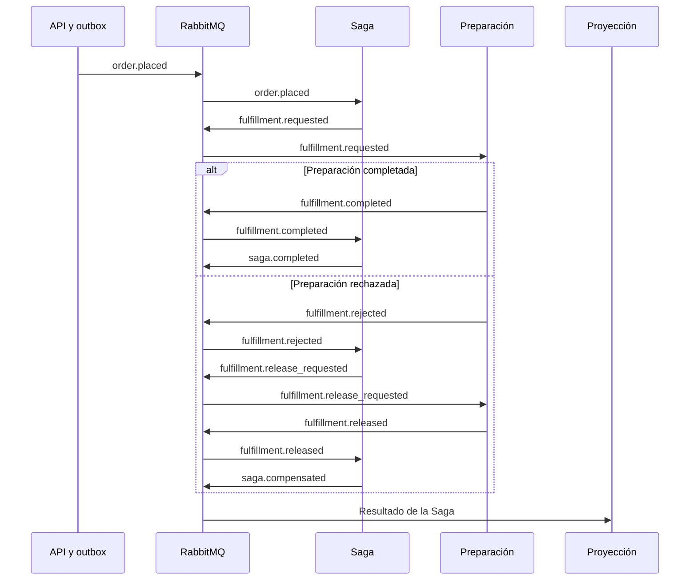

# Pedidos con colas, Saga y outbox

El [ejemplo de pedidos](../example/) usa código original y datos sintéticos. Crea un pedido por HTTP y sigue su procesamiento asíncrono por RabbitMQ. Puedes ejecutar los comandos desde Terminal en macOS o desde Ubuntu en Windows con WSL 2.

```bash
./example/smoke.sh
```

La prueba arranca una pila aislada y comprueba un pedido completado, un rechazo compensado, un reintento tras un fallo transitorio y una reentrega tras cerrar el canal antes del ACK. En la reentrega, el consumidor reconoce el mismo ID de evento y aplica el efecto una sola vez. La prueba también comprueba que un mensaje inválido termina en la cola de mensajes fallidos.

## Piezas del flujo

| Componente | Responsabilidad |
| --- | --- |
| API de pedidos | Acepta la solicitud y guarda el pedido y su evento en la misma transacción. |
| Publicador del outbox | Envía eventos pendientes a RabbitMQ y registra la publicación tras recibir confirmación. |
| RabbitMQ | Enruta mensajes a colas por clave de enrutamiento. Las colas permiten que cada consumidor avance a su ritmo. |
| Orquestador de Saga | Guarda el progreso y decide qué comando emitir. Cuando falla un paso de negocio, ordena la compensación. |
| Consumidor de preparación | Procesa las órdenes de preparación y compensación y emite el resultado. |
| Proyección de lectura | Consume los resultados y mantiene una vista consultable del flujo. |

Los servicios conservan su propio estado. En este laboratorio los almacenes son archivos SQLite en volúmenes de Compose. Un servicio puede escribir en su base de datos aunque el intermediario quede temporalmente inaccesible. El publicador retoma el outbox cuando se recupera la conexión.

## Explorar pedidos y colas

```bash
docker compose -f example/compose.yaml up -d --build --wait
curl -fsS -X PUT http://127.0.0.1:8081/orders/pedido-verde
curl -fsS -X PUT 'http://127.0.0.1:8081/orders/pedido-rojo?fail=true'
curl -fsS http://127.0.0.1:8082/orders/pedido-verde
curl -fsS http://127.0.0.1:8082/orders/pedido-rojo
docker compose -f example/compose.yaml exec rabbitmq rabbitmqctl list_queues name messages_ready messages_unacknowledged
docker compose -f example/compose.yaml logs publisher saga fulfillment projection
docker compose -f example/compose.yaml down
```

La API recibe los pedidos en el puerto 8081 y la proyección responde en el 8082. Repite las consultas si la vista todavía no recibió el resultado. Espera `completed` para el pedido verde y `compensated` para el rojo. Usa identificadores diferentes al repetir el ejercicio con el mismo volumen. Si algún puerto está ocupado, configura `EXAMPLE_PORT` o `EXAMPLE_PROJECTION_PORT` al arrancar Compose.

RabbitMQ separa los comandos en `lab.commands` de los eventos en `lab.events`. Las colas `lab.saga`, `lab.fulfillment` y `lab.projection` tienen sus propias colas de reintento y de mensajes fallidos. La Saga recibe `order.placed`, envía `fulfillment.requested` y termina con `saga.completed` o, tras recibir `fulfillment.released`, con `saga.compensated`.



## Qué observar

- **Confirmación de publicación y ACK de consumo.** La primera indica que el intermediario aceptó la publicación. El segundo indica que un consumidor terminó el procesamiento. Si la confirmación se pierde, el mismo evento puede publicarse o entregarse otra vez. Guarda la marca de deduplicación junto al efecto de negocio. [Confirmaciones y ACK en RabbitMQ](https://www.rabbitmq.com/docs/confirms)
- **Reintento y cola de mensajes fallidos.** Un fallo transitorio admite un nuevo intento. Un mensaje inválido o que agota el límite llega a la cola de mensajes fallidos. Inspecciona el motivo antes de decidir si reenviarlo. [Intercambios de mensajes fallidos](https://www.rabbitmq.com/docs/dlx)
- **Compensación.** Es una operación de negocio posterior. La Saga la solicita explícitamente y espera su resultado antes de cerrar el flujo.
- **Correlación.** Sigue el mismo pedido en los registros del publicador y de los consumidores. Compara el estado de la Saga con la proyección y con los mensajes pendientes en el intermediario.

La topología de esta página se ejecuta con Compose. Puedes comparar cómo se trasladaría a [Container Apps, Functions y App Service](azure-variantes.md). La [práctica de k3s](k3s.md) usa la API sintética sencilla para aislar Terraform y Kubernetes.
